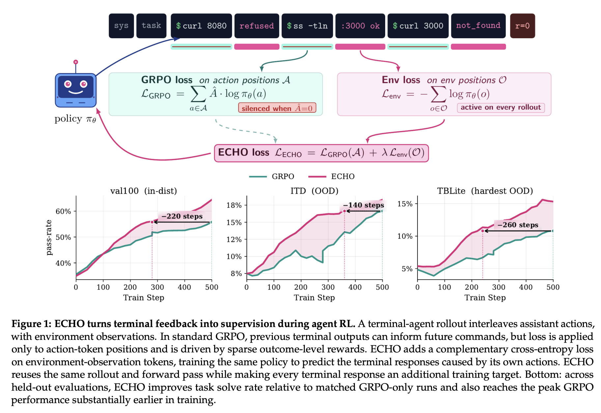
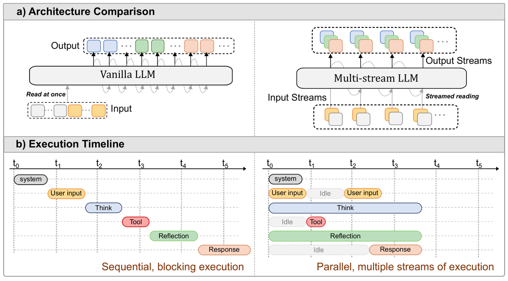
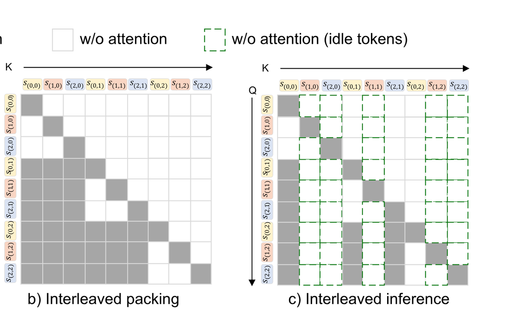
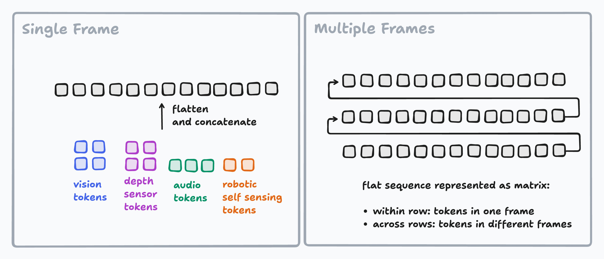
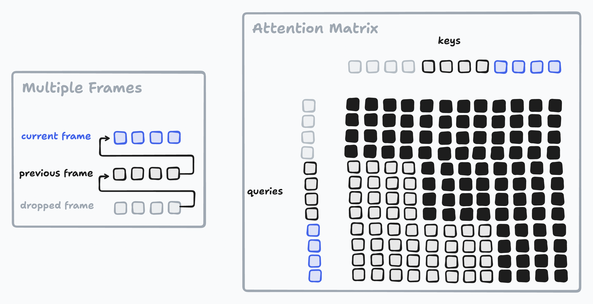
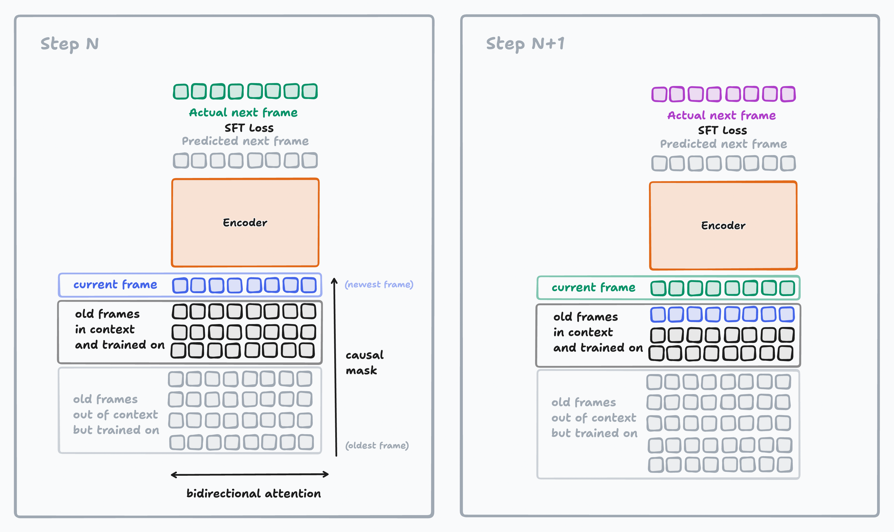
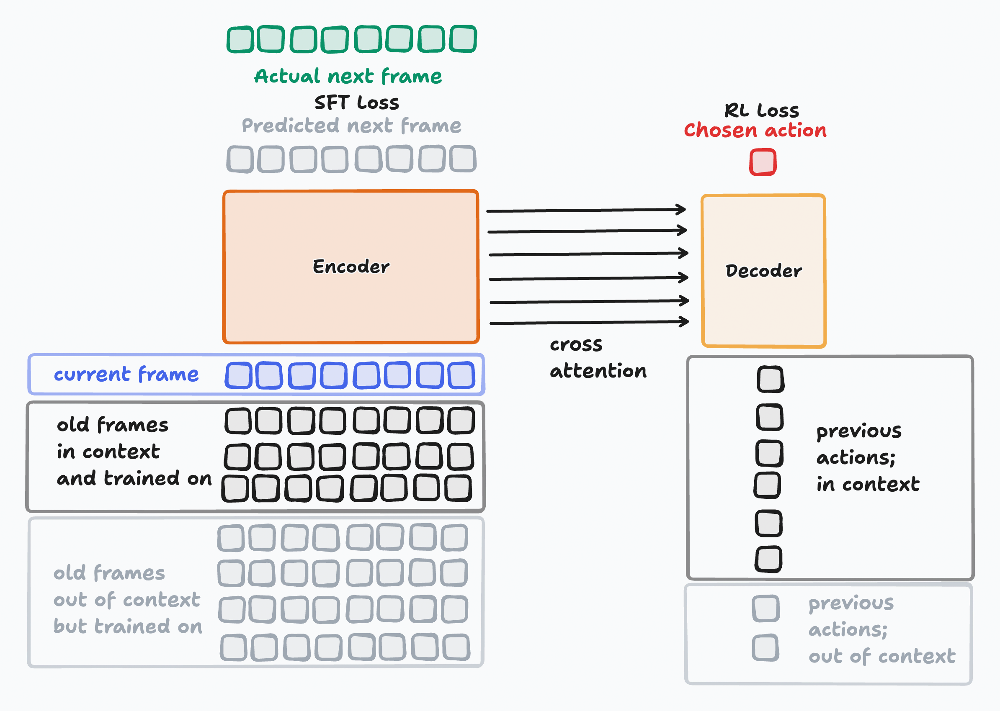
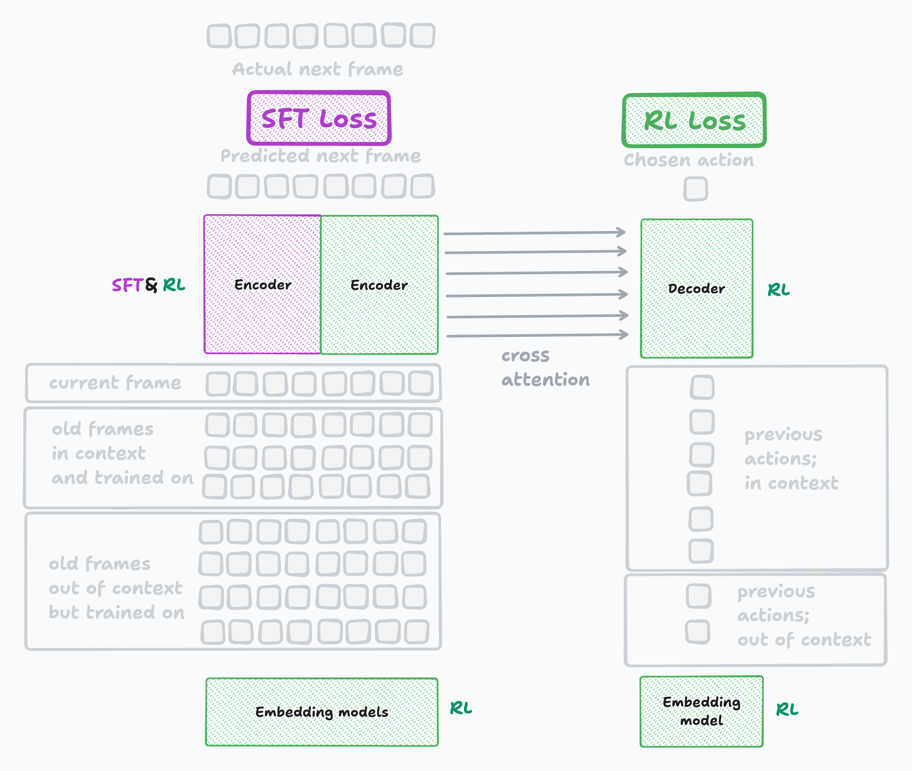
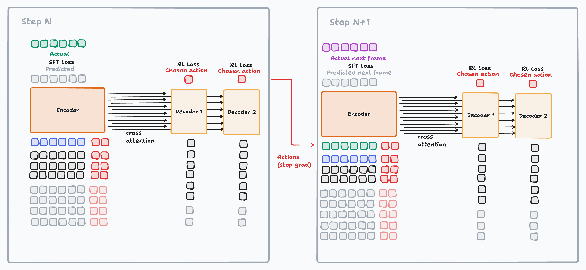

My dream AI is one that:

- learns continually in its weights
- online and in real time
- with arbitrary modalities at the input and output

In my opinion, the solution is a combination of [Multi-Stream LLMs](https://arxiv.org/abs/2605.12460) / [Interaction models](https://thinkingmachines.ai/blog/interaction-models/) and [ECHO](https://arxiv.org/abs/2605.24517) an objective, with a few tweaks, including an Encoder-Decoder design. This blog post will first introduce these existing ideas individually, then present the objective and architecture I have in mind, and finally discuss why each decision was made.

Why am I writing this theoretical post instead of implementing it? Because it will require a lot of research to figure out the details, which I cannot simply perform. Yet I want to get the ideas out there and start a conversation. As a result, the post is highly speculative.

*This post is a partner post to [my previous one on Continual Learning](https://snimu.github.io/2026/11/01/continual-learning-online-and-offline.html). For any technique presented here, you can imagine the ways in which the data that is generated online generated can be used to improve models offline.*

## ECHO

I believe that ECHO will be the central objective for real-time continual learners with arbitrary modalities at input and output.

Whether it works well for online learning in pure LLMs I don't know, but I will present it in this domain to separate explaining the objective from explaining the architecture. I'm sure that there will be challenges with stability and more; for the sake of presenting the central ideas that I'm confident on, I will ignore these.

### What is ECHO

The technique is simple: we do RL on assistant tokens, like we normally do, while performing SFT on the tool outputs (environment tokens). That way, the model learns to internalize the world dynamics, while improving its own capabilities for making decisions. The original paper showed this working very well in terminal settings, as demonstrated by its Figure 1:

So what's the point of ECHO in continual learning?

### Why SFT on environment tokens

In LLMs, I mean two things by environment tokens: tool outputs (like in the paper), and user tokens.

SFT on user tokens is user simulation and should thus help the model internalize user intent. I often see GLM-5.3 do blocking tool calls in [prime-agent](https://github.com/PrimeIntellect-ai/prime-agent). When I correct it multiple times it usually sticks for a while, but after a few compactions the behavior degrades again. The context fights the model's learned biases, which is a losing battle; ECHO can help.

SFT on tool outputs is similarly useful. Getting trained on code outputs, including error messages, [helps models more quickly learning new coding languages](https://www.primeintellect.ai/blog/true-agents-model-the-world), and the same feedback mechanism will help them in any novel situation: a new harness, new tools, a new website, all without having to bloat the compaction with more and more rules.

Another advantage of SFT on tool outputs is that the tool outputs often show concrete information that the model needs: web search results and web pages, the contents of documents, other agents' messages in multi-agent systems. When the model amortizes these facts in its weights, it won't have to look them up over and over again, it won't forget about them when it reasons about new facts, and it can better see connections between disparate facts over the course of many, many compactions (the compaction summary still stays relevant of course). Often, these facts are only relevant to a specific rollout: if we ever want to persist the online improvements a model made, we need [offline refinement](https://snimu.github.io/2026/11/01/continual-learning-online-and-offline.html) to decide what to train on and what not.

### Why online RL

SFT on environment tokens teaches the model to predict the environment dynamics, given its own actions. RL on assistant tokens teaches the model what actions to take, given the environment. [Without this, the SFT would degrade performance, or not improve it](https://bhoy1.github.io/echo-babyai-findings/); the two losses are complementary.

Doing RL online is, of course, extremely challenging in the batch size 1, group size 1 regime we are in during online continual learning. One reason is stability given the very sparse gradient; I don't know enough about this but am confident that it can be solved at least for ~day-long rollouts. The other reason is that it's difficult to get accurate reward without a comparison to other rollouts.

In my opinion, there are two solutions to this problem.

The first solution is to use privileged information online.

The easiest way to do that is to use environment feedback, including a human's. If it exists, a human's feedback or other external signals will be sparse but valuable, and a judge can analyze hundreds of turns leading up to it, determine their contribution to the human judgement, and assign corresponding rewards.

Another source of privileged information is a delay between action and judgement, which allows the consequences of the action to become more and more clear.

There is a tradeoff here: the longer you delay updates, more you delay learning. Furthermore, the more you delay RL updates, the more SFT weight updates happen in the meantime. This leads to more off-policy RL updates. Modern algorithms are pretty good at dealing with that, and we can accumulate gradients over a few SFT steps to make the updates less frequent, but this has limits. Clearly, there is some optimal delay allowing for enough privileged information without delaying learning too much or causing excessive off-policy-ness.

The second solution is to get the judge to be extremely good. The way to get it good is offline refinement: you have many, many full rollouts available for privileged information, and all the time in the world to improve the judgement quality, and can distill those improved judgements into the policy without privileged information.

This judge setup is very hard to achieve with small models, making this difficult to try out experimentally. I can also see some issues with stability. Finally, I'm far from having figured out every detail. However, I still believe that the method has great potential, especially in multi-modal, real world, real time applications, which provide far higher data density to train on, and usually richer worlds to model.

### Why ECHO in real-time, multi-modal settings

In real-time, multi-modal settings, ECHO becomes even more important.

[From Pixels to BFS: High Maze Accuracy Does Not Imply Visual Planning](https://arxiv.org/abs/2603.26839) shows that maze-solving LLMs often have no intuitive understanding of mazes, even if they solve them well. Instead, they use brute force in their reasoning:

> Rather than spatial planning, models translate the image into a token-level grid representation and then perform *serial path enumeration*: they brute-force the solution step by step in natural language, consuming thousands of reasoning tokens for a task that requires no deliberation for a human. When the path is too long to enumerate within the token budget, the model gives up—not because it cannot see the maze, but because it runs out of space to think.

This makes sense when they are trained only with RL: all that RL on model outputs can train is the model producing better model outputs. When the difficulty is in modeling the world, the model has to model the world inside its reasoning, with strategies that generalize. That can make for ugly reasoning.

SFT on output tokens would instead help the model internalize environment dynamics intuitively, in the forward pass instead of the reasoning tokens.

There is evidence for this: [ECHO on BabyAI](https://bhoy1.github.io/echo-babyai-findings/) trained LLMs with either pure RL on model outputs, pure SFT on tool outputs, or ECHO, on a maze-like game with partial observability. The work allowed no reasoning tokens, only tool calls, which gets closer to real-time environments. While pure SFT underperformed RL, ECHO outperformed it consistently, and by a large margin.

Since mazes are closer to multi-modal, real-world, real-time deployments than a coding agent is, the evidence matters for what matters to me.

## Multi-Stream LLMs

The [Multi-Stream LLMs](https://arxiv.org/abs/2605.12460) paper separates different roles to run in parallel: User, System, Thinking, Assistant, Tool Calls, Tool Outputs. This is illustrated in the Figure below, taken from the paper:

They achieve this by (1) adjusting positional embeddings so that all tokens from different streams have the same temporal position at the same timestep, (2) adding a second positional embedding to distinguish the streams, and (3) masking attention such that tokens only attend to tokens from previous timesteps (all streams to mix them), but not to parallel tokens of the same timestep (to retain separation for parallelism). This is illustrated in the figure below (the first suffix shows the stream embedding, the second the positional embedding; the grayed out areas show the mask):

The advantages they see are:

- Better separation of concerns between roles, making prompt injection attacks harder
- Lower latency due to increased parallelism (neural parallelism, as opposed to agentic parallelism like in multi-agent systems)
- Interruption by simply sending new user tokens while the model is still talking, which allows for seamless steering

## Interaction models

Thinking Machines [Interaction models](https://thinkingmachines.ai/blog/interaction-models/) don't split their streams by role. They split them by modality and by scale. A small model takes video and audio as inputs and produces audio at the output to interact with the user, as well as text both at the in- and output so that it can communicate with the second model: a larger, classic VLM that works asynchronously and does the bulk of the long-range, abstract reasoning. Here, the outputs of the small model don't happen in parallel though, it just switches quickly between modalities (I might have misunderstood some aspects of their setup, I found the blog post slightly confusing if I'm being honest). What they get out of this is:

- Real time interactivity where user and model can talk simultaneously and react to each other immediately
- Multimodality (in theory, arbitrary modalities at the input and output)
- Combined action-taking and communication (browse the web while talking to the user)
- Long range, abstract reasoning
- Time-awareness

## The architecture

I imagine a one-Encoder, multiple-Decoders architecture, working on tokens for all modalities. How those tokens are constructed is not important for now; I care about how their embeddings are trained, and how they are used to continually train the larger model.

The Encoder perceives and predicts the external world. Its inputs are delivered as frames: one frame is a string of tokens from all modalities: a video frame, a bunch of audio data, robot-arm-positioning data, text, and so on, all flattened and concatenated.

It applies bidirectional attention to the entire frame, and Attention between frames is causal.

From the current frame, the model predicts the next frame's tokens. Each predicted token corresponds to the next frame's token at the same position. At test time, we calculate the prediction loss between the predicted and real input and do a weight update (async with the forward pass on that frame). After the newest frame has been used to make a prediction, we drop the oldest frame from the Attention window to keep it finite.

The Decoder produces action tokens. It takes as inputs its own past outputs, so that the model has a view on what it has done before. Its Attention mask is causal (unless we decode multiple actions per forward, but let's ignore that for simplicity). Like the Encoder, the Decoder also drops old tokens as new ones come in. It additionally gets information from the Encoder through Cross Attention (or a similar mechanism) at every layer (or every few layers). It produces action tokens as its output, and we apply RL to the action tokens, using similar methods as described in the previous section (much research to be done here).

The RL loss updates the Decoder weights, the Encoder weights exposed to its gradients through Cross Attention, and, importantly, the embeddings of the Encoder's input tokens, which the SFT loss doesn't update. Sampled Decoder outputs are concatenated to the inputs of the Encoder at the next frame. No SFT loss is applied to those tokens in the Encoder.

There can be many Decoders: one producing action tokens for a robotic arm, one producing language tokens to think about its actions (never actively used anywhere except to inform further actions), another uses language to do tool calls like an LLM (requires tool calls being parse-able across multiple time-steps), yet another communicates with a user through audio, and so on. Their interactions are mediated through the Encoder: their outputs are concatenated to the Encoder's inputs (no SFT loss is ever calculated on them), which in the next time step mixes them in its layers, and then feeds the mixed representations back to the Decoders through Cross Attention.

## Explaining my decisions

- Why split into Encoder and Decoders?

The obvious answer is that it gives us all the advantages of Multi-Stream LLMs and Interaction models: parallel streams, seamless steering, and so on. But the others achieve those advantages with just one model, one Attention window (ignoring the slow model from Thinking Machines, that's a different paradigm more reminiscent of [my companion post](https://snimu.github.io/2026/11/01/continual-learning-online-and-offline.html)). So why split the model up like this?

One way to view the Encoder-Decoders split is as a form of parallelism scaling. Multi-agent systems are ultimately just a way of scaling inference compute by increasing parallelism, splitting context across agents. Similarly, splitting the Attention operation itself into multiple shorter streams allows us to scale inference compute without hitting limits early. More Decoders means more parallel Attention capacity. While this is less scalable than multi-agent systems, the communication capacity through latent vectors is far higher.

A second advantage of the split is the ability to do forward passes at different frequencies: you could produce five thinking tokens per input frame, autoregressively; or one thinking token per five input frames. You can sample fine-grained robotics outputs more often than tool calls done in language tokens. And so on.

However, the main reason is that we do ECHO, meaning that we do SFT on the environment tokens. This helps the model memorize what was going on beyond the context window, so it's okay to have many environment tokens at the input. But we want to do RL on the output tokens, which means we cannot do SFT on them, and so the model cannot memorize what it did in its own weights. It's easy to apply different losses to different parts of the same context window, but then we need to drop both the inputs and the outputs at the same time. If we split them up instead, each time step adds fewer tokens to the Attention window, and thus the amount of time that Attention can look back for is increased.

This effect is especially pronounced in the real world, where there is a vast asymmetry between input and output information density. At the input, we have video, audio, actuator positions, and more, each with dozens to thousands of tokens per frame. At the output, we have low single-digit token numbers per frame.

This means that if we keep the Attention window the same size between the Encoder and Decoders but assign different token streams to each, the Decoders will be able to see much, much further back in time than the Encoder, which allows the model to remember what it did for very long without doing SFT on its own outputs.

- So why concatenate Decoder outputs to the Encoder inputs?

There are two simple reasons. One, the Encoder benefits from seeing the model outputs. It means that the model predicts the next frame *given its own actions* instead of just predicting it in a vacuum. Two, we have multiple Decoders with independent token streams. The Encoder serves to mix them and communicate the information to all of them via Cross Attention on its latents.

The fact that we give the Encoder the actual sampled outputs instead of the Decoders' latents also has two simple reasons: One, the Encoder should know what the model *actually did*, not the distribution of actions it thought it *might take*. Two, it detaches the two and allows us to do pretraining with teacher forcing, since the Decoder outputs at time T will be concatenated with the Encoder input frame at time T+1.

- Why prediction in tokens?

This might be the part I'm the least confident about; still, it feels right to me.

For model outputs it makes sense because it easily allows for sampling and thus RL. Many of the model outputs will be language, where the choice is obvious, but even inputs like vision and audio can be tokenized well.

For the next-frame prediction it means that we can control the space in which we predict: If we have some way to determine discrete tokens, then we can train their embeddings to create the latent space that maximizes the utility of the model's next-frame predictions to the reward.

In other words, we can use the RL signal from the Decoders to update the embedding models. Whether we want to do this online or only during [offline refinement](https://snimu.github.io/2026/11/01/continual-learning-online-and-offline.html) is an open question, like many others.

## Final words

I keep mentioning [the companion post](https://snimu.github.io/2026/11/01/continual-learning-online-and-offline.html) to this one. The reason is that I believe that the interplay between online and offline weight updates will be crucial, and the ideas presented above can both benefit from and add to them (example: the Encoder can act as a latent simulator for offline refinement). It made sense to split up the posts, but this one is incomplete without the other.

  I'm pretty confident in the companion post. I cannot say the same for this one: The ideas make sense to me, but they obviously leave lots of details undecided, and each of those details could break it. Not to mention that I'm not an expert in the area and could simply have overlooked other work.

## Acknowledgements

I thank [Ilija Lichkovski](https://x.com/carnot_cyclist) for two rounds of highly productive reviews on this blog post, as well as several helpful personal discussions.

